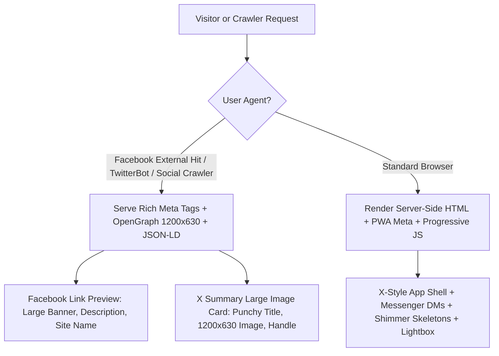
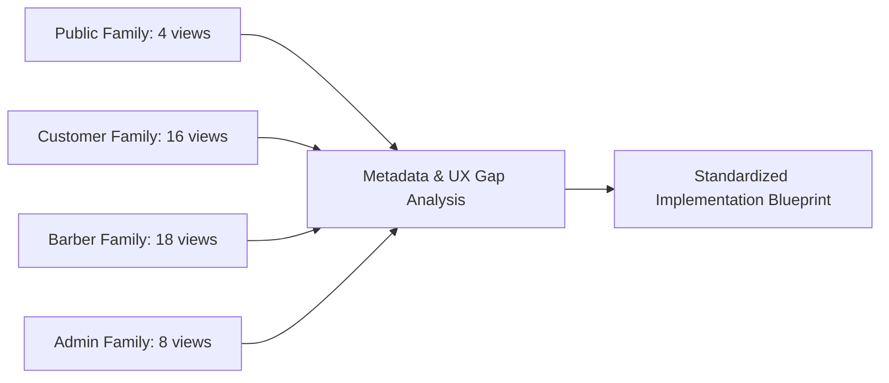
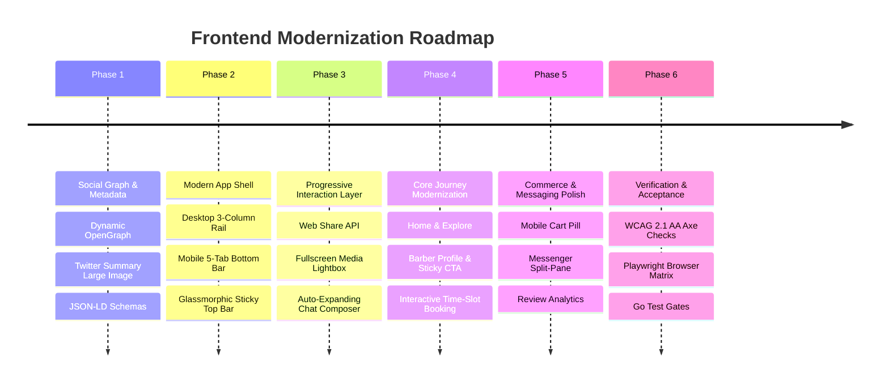
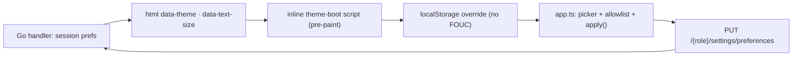

# De Go Salon — Frontend Modernization & Social Optimization Specification
**Standards Target: Meta (Facebook) & X.com (formerly Twitter) Consumer Grade**  
**Design System: Dawn Canopy Forest & Warm Gold System Tokens — Multi-Theme & Sharp Operational Modes**  
**Architectural Foundation: Go Server-Side Rendered (html/template) + Progressive TypeScript Enhancement**  
*Last Updated: 18 October 2026 — added §2.2 Multi-Theme Token Architecture, §2.3 Display Preferences & Sharp Operational Mode, §5.7 and §6.5.*

---

## 1. Executive Vision & Standard Definition

### 1.1 The Objective
De Go Salon is a multi-sided marketplace connecting customers, professional barbers, and shop administrators across Nigeria's 36 states and FCT. While the backend architecture features hardened PostgreSQL transaction boundaries, canonical geographical normalization, scoped SQL pagination, and secure authentication, the frontend interface must now be elevated to match the world-class consumer standards established by **Facebook (Meta)** and **X.com (formerly Twitter)**.

Meeting this benchmark requires two tightly coupled engineering dimensions:
1. **The Social Graph & Discovery Dimension (Facebook OpenGraph & X Cards Standard):** Every public and shareable view must present high-fidelity, 1200×630px rich media previews (`summary_large_image`), canonical URLs, localized meta attributes, verified domain attribution (`fb:app_id`, `twitter:site`), Schema.org JSON-LD microdata (`BeautySalon`, `Product`, `BreadcrumbList`), and native 1-click sharing interfaces.
2. **The Consumer Interaction & UI/UX Dimension (Facebook & X Web App Standard):** The interface must deliver the operational responsiveness, feed fluidness, and tactile micro-interactions of top-tier consumer apps:
   - Modern multi-column responsive app shells (X-style left navigation rail, central stream, right contextual rail on desktop; sticky blurred header + 5-tab bottom navigation bar on mobile).
   - Zero Cumulative Layout Shift (CLS = 0) with animated shimmer skeleton screens (`@keyframes shimmer`) instead of jarring empty states.
   - Micro-interactions with haptic-like active scaling (`transform: scale(0.97)`), instant optimistic feedback, and smooth state transitions.
   - An immersive fullscreen media lightbox with multi-photo gallery cycling (`ArrowLeft`/`ArrowRight`), touch swipe-to-dismiss, and embedded service CTAs.
   - A Messenger / X DMs-grade chat interface featuring auto-expanding composer textareas, floating "Scroll to bottom" unread pills, bubble tails, and instant keyboard dispatch.
   - Mobile commerce & booking ergonomics with sticky bottom action bars (Facebook Marketplace / Instagram Shop style) and interactive time-slot chip selectors.

### 1.2 Core Architectural Principles
- **Design System Fidelity:** Maintain the exact Forest & Warm Gold **Dawn Canopy** palette. No arbitrary generic gray-scale or off-brand colors may be introduced. Dawn Canopy is the **default theme**, not the only theme — see §2.2: every theme re-colours the same semantic token set, and danger red stays reserved in all of them.
- **Theme-Able by Construction:** No component hardcodes a raw colour, font-size in pixels, or corner radius. Every surface, ink, border, accent and atmospheric layer resolves through the semantic tokens in §2.1–§2.3, so a theme or text-size change repaints the whole platform without touching a single template.
- **Server-Rendered Authority:** The Go server (`net/http` + `html/template`) remains the single source of truth for business invariants, CSRF tokens, session state, permissions, and data validation. No client-side SPA framework (React, Vue, Angular) migration.
- **Progressive TypeScript Enhancement:** `frontend/app.ts` (compiled to `static/app.js`) enhances accessibility, speed, and usability. Every page must remain fully operational and navigable with JavaScript disabled or blocked.
- **Deterministic Build Pipeline:** Build rules remain strictly enforced (`npm run typecheck`, `npm run build`, `git diff --exit-code -- static/app.js`, `go test ./...`).

---

## 2. Design System Tokens & Visual Language

All layout primitives, social previews, shell containers, and interactive elements adhere to the semantic token architecture:

### 2.1 CSS Custom Properties (`static/app.css` & `static/ui.css`)
```css
:root {
  /* Surface Layers */
  --void: #091613;          /* Deepest background void (canvas base) */
  --base: #10221d;          /* Base container & input field surface */
  --surface: #193129;       /* Standard panel, card, and modal backdrop */
  --surface-hi: #254137;    /* Elevated surface, hover states, active tabs */
  --surface-trans: rgba(25, 49, 41, 0.78); /* Frosted glass backdrop */

  /* Structural Dividers & Borders */
  --border: #355348;        /* Subtle container boundaries */
  --border-hi: #527466;     /* Prominent borders, interactive focus outlines */
  --border-subtle: rgba(194, 212, 199, 0.12); /* Feed dividers & list rules */

  /* Typography Colors */
  --ink: #f8f5e9;           /* Primary cream typography (high contrast) */
  --ink-muted: #c2d4c7;     /* Secondary description & navigation label */
  --ink-faint: #9db9a8;     /* Timestamps, metadata, and helper hints */

  /* Accent & Interaction Accents */
  --signal: #f4cb78;        /* Warm gold accent for primary CTAs, stars, highlights */
  --signal-ink: #19251c;    /* High-contrast dark forest ink for gold buttons */
  --signal-hover: #fae0a2;  /* Elevated gold hover state */

  /* Functional Status Colors */
  --danger: #ef4444;        /* Destructive actions, errors, cancellations */
  --danger-surface: #4a2227;/* Error panel background */
  --danger-ink: #ffd0d5;    /* Error typography */
  --warning: #f59e0b;       /* Pending status, alert notifications */
  --warning-surface: #463a20;
  --warning-ink: #ffe0a3;
  --success: #22c55e;       /* Confirmed bookings, completed status */
  --success-surface: #173c2b;
  --success-ink: #b7f7cf;
  --info: #38bdf8;          /* Info banners & active badges */
  --info-surface: #1b3348;
  --info-ink: #c4e7ff;

  /* Geometry & Typography */
  --panel-radius: 0.875rem; /* 14px for panels, dialogs, cards */
  --control-radius: 0.5rem; /* 8px for buttons, inputs, pills */
  --pill-radius: 9999px;    /* Avatars, status chips, segmented controls */
  --font: Inter, ui-sans-serif, system-ui, -apple-system, BlinkMacSystemFont, "Segoe UI", Roboto, sans-serif;
  --font-mono: ui-monospace, SFMono-Regular, Menlo, Monaco, Consolas, monospace;

  /* Layout Widths (Facebook / X Standards) */
  --shell-nav-width: 260px; /* Desktop Left Navigation Rail */
  --shell-rail-width: 320px;/* Desktop Right Context Rail */
  --feed-max-width: 680px;  /* Optimal reading stream width */
  --page-max-width: 1200px; /* Full desktop container constraint */
}
```

### 2.2 Multi-Theme Token Architecture (Forest · Midnight · Daylight · Ocean · Stone)

Dawn Canopy is **theme one of five**, not the sole palette. Every theme redefines the *same* set of semantic tokens, so no template, partial, or TypeScript module ever hardcodes a raw colour — only the `:root` block (§2.1) and the `html[data-theme="…"]` override blocks ship hex values. This is the pattern proven in the reference system at `multi-agent-orchestrator/sample/nativity-guard/frontend/src/theme.css` (its `preferences.ts` switches `data-theme` on `document.documentElement`).

| Theme | Intent | `--void` / `--base` / `--surface` | `--ink` / `--ink-muted` | `--signal` / `--signal-ink` |
| :--- | :--- | :--- | :--- | :--- |
| **Forest** *(default)* | Dawn Canopy brand. Deep evergreen shelter, warm gold action. | `#091613` / `#10221d` / `#193129` | `#f8f5e9` / `#c2d4c7` | `#f4cb78` / `#19251c` |
| **Midnight** | True-black OLED dark for night browsing and low-light use. | `#000000` / `#0a0a0a` / `#141414` | `#f5f5f5` / `#b5b5b5` | `#f4cb78` / `#121212` |
| **Daylight** | Light theme for bright outdoor daylight; the only light surface set. | `#d8d8d2` / `#f7f7f5` / `#ffffff` | `#1a1a1a` / `#4a4a4a` | `#b8851a` / `#ffffff` |
| **Ocean** | Cool blue alternative for customers who dislike warm/green casts. | `#051025` / `#0a1a30` / `#10263f` | `#eaf2fb` / `#b6cbe4` | `#8bd3f7` / `#082238` |
| **Stone** | Warm neutral earthy alternative; softer than Forest. | `#1a1714` / `#232019` / `#2f2a22` | `#f4ede0` / `#c9bda9` | `#e8b478` / `#231a0c` |

**Hard rules for every theme:**

1. **Same token contract, different values.** A theme override block may only reassign existing tokens — never introduce a new token name, and never delete one. If a new token is needed, it is added to `:root` first and then to all five themes.
2. **Semantic roles are preserved.** `--danger` stays reserved for destructive/urgent states in every theme; `--signal` is always the *one* primary action colour. Daylight darkens the gold to `#b8851a` precisely so it keeps ≥ 4.5:1 against white; it must not reuse the Forest gold.
3. **Atmosphere recolours too.** The aesthetic layers that sit *outside* the base palette — glass panel tints (`--panel-tint-1/2`, `--panel-border`), the sticky bar (`--bar-bg`, `--bar-border`), the hero gradient stops (`--hero-end-1`, `--hero-mid`, `--hero-end-2`, `--hero-arc-*`, `--hero-warm`, `--hero-star`, `--hero-dot`), the body depth-layer opacity/glow (`--depth-tilt-opacity`, `--depth-glow-*`) and the skeleton shimmer (`--skeleton-a/b`) — are theme-scoped variables, not literals in the component CSS. The reference `theme.css` defines all of them for all five themes.
4. **Native controls follow the theme.** Set `color-scheme: dark` on the dark themes and `color-scheme: light` on Daylight so browser-rendered `<input>`, `<select>`, scrollbars and date pickers match instead of flashing a wrong-scheme control.
5. **Contrast is a gate, not a hope.** Each theme must independently pass WCAG 2.1 AA: ≥ 4.5:1 for body text and ≥ 3:1 for large text and UI boundaries (§5.6). Verify text, focus rings, status chips and the landing hero in all five themes on a phone in daylight.
6. **`theme-color` tracks the active theme.** The two `<meta name="theme-color">` values in §3.1 (`prefers-color-scheme: dark|light`) are the browser-chrome fallback; once a theme is applied the boot script (§2.3) rewrites the matching `theme-color` to that theme's `--void`/`--base` so the mobile status bar matches the page.

```css
/* static/theme.css — loaded after static/app.css (base = Forest) */
:root { /* §2.1 Dawn Canopy tokens ARE the Forest theme */ }

html[data-theme="midnight"]{
  --void:#000000; --base:#0a0a0a; --surface:#141414; --surface-hi:#1e1e1e;
  --border:#2a2a2a; --border-hi:#3a3a3a;
  --ink:#f5f5f5; --ink-muted:#b5b5b5; --ink-faint:#888888;
  --signal:#f4cb78; --signal-ink:#121212;
  color-scheme:dark;
}
html[data-theme="daylight"]{
  --void:#d8d8d2; --base:#f7f7f5; --surface:#ffffff; --surface-hi:#ebebe8;
  --border:#d0d0cc; --border-hi:#a8a8a4;
  --ink:#1a1a1a; --ink-muted:#4a4a4a; --ink-faint:#707070;
  --signal:#b8851a; --signal-ink:#ffffff;
  color-scheme:light;
}
html[data-theme="ocean"]{ /* surface #10263f · ink #eaf2fb · signal #8bd3f7 */ color-scheme:dark; }
html[data-theme="stone"]{ /* surface #2f2a22 · ink #f4ede0 · signal #e8b478 */ color-scheme:dark; }
```

### 2.3 Display Preferences, Text Size & the Sharp Operational Mode

#### A. Display Preferences (theme + text size), persisted two ways

Theme and text size are **user preferences**, not per-page choices. They persist in two places, exactly as the reference system does:

1. **`localStorage`, applied before first paint** so a returning visitor never sees a flash of the default theme (no FOUC). This is progressive enhancement and stays client-side.
2. **The server record is the source of truth once signed in**, so the choice follows the user to any device. The Go handler is authoritative; `localStorage` is only a fast local cache.

Values are never trusted raw — a value read from `localStorage` or the wire is run through an **allowlist normaliser** (`theme ∈ {forest,midnight,daylight,ocean,stone}`, `textSize ∈ {standard,large,xlarge,xxlarge}`) and anything unrecognised falls back to the default (`forest` / `standard`). This prevents a crafted value from injecting an arbitrary token set or breaking the layout.

```ts
// frontend/app.ts — normalise + apply (progressive enhancement)
const THEMES = ["forest","midnight","daylight","ocean","stone"] as const;
const TEXT_SIZES = ["standard","large","xlarge","xxlarge"] as const;
type Theme = typeof THEMES[number];
type TextSize = typeof TEXT_SIZES[number];

function normalise(raw: unknown): { theme: Theme; textSize: TextSize } {
  const p = (raw ?? {}) as { theme?: unknown; textSize?: unknown };
  return {
    theme: THEMES.includes(p.theme as Theme) ? (p.theme as Theme) : "forest",
    textSize: TEXT_SIZES.includes(p.textSize as TextSize) ? (p.textSize as TextSize) : "standard",
  };
}
function apply(prefs: { theme: Theme; textSize: TextSize }) {
  const root = document.documentElement;
  root.dataset.theme = prefs.theme;
  root.dataset.textSize = prefs.textSize;
  // keep the browser-chrome colour in step with the active theme
  const void_ = getComputedStyle(root).getPropertyValue("--void").trim();
  document.querySelectorAll<HTMLMetaElement>('meta[name="theme-color"]')
    .forEach((m) => (m.content = void_));
}
```

#### B. Server-Side Rendering boot (no-FOUC, works without JavaScript)

Because the platform is Go SSR, the server cannot know `localStorage`. The order of operations is:

1. The Go handler renders `<html data-theme="…" data-text-size="…">` from the **signed-in user's stored preference** when a session exists. This is the no-JavaScript path: a visitor without JS still gets their saved theme, and an anonymous visitor gets `forest`/`standard`.
2. A tiny **inline boot script** placed in `<head>` *after* the attributes and *before* any stylesheet-dependent paint reads `localStorage` and overrides the attributes only if it differs (e.g. the user changed the theme on a public page while signed out). It is inlined — not a deferred file — so it runs before first paint.
3. `frontend/app.ts` then wires the picker and, on change, writes `localStorage` immediately and `PUT`s the preference to the server when authenticated. The server write is best-effort from the client's point of view: a failed sync keeps the local choice and retries on the next change.

```html
<!-- The base layout's own <html> element carries the server-rendered attributes
     (templates/base.html):  <html data-theme="{{.Theme}}" data-text-size="{{.TextSize}}">
     The partial below is inlined in <head>, before the page stylesheets. -->
<script>
  (function () {
    try {
      var p = JSON.parse(localStorage.getItem('dgs-display-v1') || '{}');
      var t = ['forest','midnight','daylight','ocean','stone'];
      var s = ['standard','large','xlarge','xxlarge'];
      var el = document.documentElement;
      if (t.indexOf(p.theme) > -1) el.dataset.theme = p.theme;
      if (s.indexOf(p.textSize) > -1) el.dataset.textSize = p.textSize;
    } catch (e) { /* storage unavailable — server-rendered defaults stand */ }
  })();
</script>
```

Suggested server surface (mirrors the reference `/settings/preferences`): a `user_preferences` table keyed by user, and `GET`/`PUT /{role}/settings/preferences` returning `{ theme, textSize, notifyAlerts, … }`. The same normaliser/allowlist is enforced in Go so an unknown value can never be stored or rendered.

#### C. Text Size — an accessibility scale, not a redesign

Text size is a genuine accessibility feature (the reference system calls it "make everything bigger if small text is hard to read"), implemented as a root font-size scale so it propagates through every `rem`-based dimension:

```css
html[data-text-size="standard"] { font-size: 100%; }
html[data-text-size="large"]    { font-size: 112.5%; }
html[data-text-size="xlarge"]   { font-size: 125%; }
html[data-text-size="xxlarge"]  { font-size: 140%; }
```

Because all spacing and type in §2.1 is expressed in `rem`, the whole layout scales with the user, including min tap targets. Gate: verify every page family at **320px width under `xxlarge`** with no horizontal scroll, clipped controls or overlapping sticky bars.

#### D. The "Sharp Operational Mode" (density, not colour)

The reference design DNA is *"calm in emergencies, warm in community spaces, **sharp in operations**."* Sharpness is a **density/typography posture for the barber and admin workspaces**, layered on top of whichever colour theme is active — it is not a sixth theme and not a per-page restyle:

- **Dense, information-rich grids** for barber dashboards, schedules, inventory and every admin table/queue, versus the generous, spacious spacing of customer discovery and booking surfaces.
- **Crisp hairline structure** — 1px borders and the semantic `--border`/`--border-hi` tokens carry the hierarchy; heavy shadows and rounded-radius blobs are avoided in operational surfaces so rows stay scannable.
- **Tabular precision** — IDs, appointment times, prices (`₦`) and counters render in the monospace tabular-numeral treatment so columns align and never jitter as values change.
- **Restrained motion** — operational screens keep the 150–250ms purposeful transitions from §3.2, never decorative animation.

Implemented as a scoped attribute (e.g. `<body data-density="sharp">` on barber/admin layouts, default `comfortable` on customer/public layouts) that only tightens spacing/radius and applies tabular numerals — it must **not** fork the colour system, and it must compose with all five themes. The natural home for these overrides is `static/ui.css` (the shared primitives layer), scoped to the sharp mode.

#### E. Graceful degradation (both preferences and atmosphere)

- **`prefers-reduced-motion: reduce`** — disable the shimmer, logo draw-in, hero drift and card lift; the base skeleton keeps a flat surface. The reference system also force-quiets every animation to `0.001ms`.
- **`prefers-reduced-transparency: reduce`** — drop the frosted `backdrop-filter` glass and the body depth layers, falling back to solid `--surface` panels so text never sits over busy artwork.
- **No JavaScript** — the server-rendered theme stands; the picker simply does not appear (it is rendered only when the enhancement script is present), and all content stays readable.

---

## 3. Facebook and X.com Benchmark Standards

### 3.1 Social Graph & Open Graph Metadata Standard
To achieve flawless rich link cards when links are shared on Facebook, X, WhatsApp, LinkedIn, and Telegram, every page must meet the following metadata rules:



#### Social Metadata Matrix
1. **Large Image Twitter Card (`twitter:card`):**
   - Must be `summary_large_image` on all public pages, discovery searches, and barber profiles. The previous `summary` card rendered a tiny square icon; `summary_large_image` renders the full-width high-impact banner expected on modern timelines.
2. **Image Aspect Ratio & Resolution:**
   - 1200 × 630 pixels (1.91:1 aspect ratio), with subject matter centered to avoid cropping on mobile feeds.
   - Dynamic URLs: Barber profiles use the shop banner or high-resolution hairstyle portfolio preview; discovery results use dynamic location cards; platform pages use the optimized brand hero banner (`/static/images/og-hero-1200x630.jpg`).
3. **Canonical URLs & Absolute Origin:**
   - Always derived from the validated HTTPS `SITE_URL` or `RENDER_EXTERNAL_URL`. Never derived from arbitrary client request headers.
   - Tracking parameters (`?fbclid=`, `?ref=`, `?utm_*`) and session IDs must never appear in canonical URLs.
4. **Platform Verification & Handles:**
   - `<meta name="twitter:site" content="@degosalon">`
   - `<meta name="twitter:creator" content="@degosalon">`
   - `<meta property="og:site_name" content="De Go Salon">`
   - `<meta property="og:locale" content="en_NG">`
   - `<meta property="fb:app_id" content="966242223397117">` (or configurable platform ID).
5. **Schema.org JSON-LD Structured Data:**
   - Structured JSON-LD microdata allows search engines and social platforms to extract real-time ratings, locations, price tiers, and service offerings.

#### Canonical Meta Partial Blueprint (`templates/partials/public-metadata.html`)
```html
{{define "public-metadata"}}
<!-- Core Meta & Theme -->
<meta name="description" content="{{.Description}}">
<meta name="theme-color" content="#091613" media="(prefers-color-scheme: dark)">
<meta name="theme-color" content="#10221d" media="(prefers-color-scheme: light)">

<!-- Open Graph / Facebook Standard -->
<meta property="og:site_name" content="De Go Salon">
<meta property="og:type" content="{{if .Type}}{{.Type}}{{else}}website{{end}}">
<meta property="og:title" content="{{.Title}}">
<meta property="og:description" content="{{.Description}}">
<meta property="og:locale" content="en_NG">
{{if .Canonical}}<link rel="canonical" href="{{.Canonical}}"><meta property="og:url" content="{{.Canonical}}">{{end}}
{{if .Image}}
<meta property="og:image" content="{{.Image}}">
<meta property="og:image:secure_url" content="{{.Image}}">
<meta property="og:image:width" content="{{if .ImageWidth}}{{.ImageWidth}}{{else}}1200{{end}}">
<meta property="og:image:height" content="{{if .ImageHeight}}{{.ImageHeight}}{{else}}630{{end}}">
<meta property="og:image:type" content="image/jpeg">
<meta property="og:image:alt" content="{{if .ImageAlt}}{{.ImageAlt}}{{else}}{{.Title}}{{end}}">
{{end}}
{{if .FbAppID}}<meta property="fb:app_id" content="{{.FbAppID}}">{{end}}

<!-- X.com (Twitter) Standard -->
<meta name="twitter:card" content="{{if .TwitterCard}}{{.TwitterCard}}{{else}}summary_large_image{{end}}">
<meta name="twitter:site" content="@degosalon">
<meta name="twitter:creator" content="@degosalon">
<meta name="twitter:title" content="{{.Title}}">
<meta name="twitter:description" content="{{.Description}}">
{{if .Image}}
<meta name="twitter:image" content="{{.Image}}">
<meta name="twitter:image:alt" content="{{if .ImageAlt}}{{.ImageAlt}}{{else}}{{.Title}}{{end}}">
{{end}}

<!-- Schema.org JSON-LD Structured Data Injection -->
{{if .StructuredData}}
<script type="application/ld+json">
{{.StructuredData}}
</script>
{{end}}
{{end}}
```

---

### 3.2 UI/UX, Layout & Micro-Interaction Standards

#### A. Modern Responsive App Shell Architecture
Facebook and X use a high-efficiency 3-column desktop layout that effortlessly collapses into an ergonomic single-column mobile app shell:

```
+---------------------------------------------------------------------------------------+
| DESKTOP (>= 1024px)                                                                   |
| +--------------------+ +-------------------------------------+ +--------------------+ |
| | LEFT NAV RAIL      | | MAIN STREAM / CONTENT FEED          | | RIGHT CONTEXT RAIL | |
| | - Brand Mark (DG)  | | - Sticky Filter / Header (Blurred)  | | - Sticky Search    | |
| | - Home             | | - Hero / Portfolio / Service Cards  | | - Trending Cuts    | |
| | - Find Barbers     | | - Infinite Stream / Shimmer Cards   | | - Top Rated Shops  | |
| | - My Appointments  | | - Full-width Feed Cards             | | - Quick Re-book    | |
| | - Messages (Badge) | |                                     | | - Support / Info   | |
| | - Cart (Count)     | |                                     | |                    | |
| | - Profile & Menu   | |                                     | |                    | |
| +--------------------+ +-------------------------------------+ +--------------------+ |
+---------------------------------------------------------------------------------------+

+------------------------------------+
| MOBILE (< 768px)                   |
| +--------------------------------+ |
| | Top Sticky Bar (Blur Backdrop) | |
| +--------------------------------+ |
| | Scrollable Content / Feed      | |
| | - Filter Chips                 | |
| | - Responsive Cards             | |
| | - Sticky Bottom Action Bar     | |
| +--------------------------------+ |
| | Bottom Nav (5 Tabs, 48px min)  | |
| | [Home] [Find] [Book] [Chat] [Me]| |
| +--------------------------------+ |
+------------------------------------+
```

1. **Desktop Left Navigation Rail (X Standard):**
   - Slim vertical rail (`240px–260px`) fixed on the left.
   - Clean, icon-forward menu items with generous tap targets (`44px` height).
   - Prominent pill-shaped Gold primary action button ("Book a Cut" / "Find Barber").
   - User account avatar with role badge and logout action docked at the bottom.
2. **Main Feed Stream:**
   - Central reading and interaction stream bounded to `640px–720px` max-width to maintain optimal typographic line lengths (60–75 characters per line).
   - Glassmorphic top bar with `backdrop-filter: blur(16px)` and translucent background (`rgba(9, 22, 19, 0.85)`).
3. **Right Context Rail (Desktop):**
   - Context-aware auxiliary rail (`300px–340px`) containing:
     - Search with instant debounce filtering.
     - "Popular Barbers in Your State" recommendation module.
     - "Trending Styles This Month" visual card feed.
     - Quick appointment summary widget.
4. **Mobile Bottom Navigation Bar (5-Tab Standard):**
   - Fixed at the viewport bottom: `bottom: 0; left: 0; right: 0; height: 60px; z-index: 50`.
   - Supports safe-area insets: `padding-bottom: env(safe-area-inset-bottom)`.
   - 5 primary destinations: **Home**, **Find**, **Bookings**, **Messages** (with unread gold badge), **Profile**.
   - Active tab indicator: Gold icon tint with subtle top glow bar.

#### B. Micro-Interactions, Perceived Performance & Skeletons
1. **Zero CLS with Shimmer Skeletons:**
   - While media or asynchronous queries load, render exact layout placeholders with an animated gradient shimmer:
   ```css
   @keyframes shimmer {
     0% { background-position: -200% 0; }
     100% { background-position: 200% 0; }
   }
   .skeleton {
     background: linear-gradient(90deg, rgba(25, 49, 41, 0.6) 25%, rgba(37, 65, 55, 0.8) 50%, rgba(25, 49, 41, 0.6) 75%);
     background-size: 200% 100%;
     animation: shimmer 1.6s infinite ease-in-out;
     border-radius: var(--control-radius);
   }
   ```
2. **Tactile Button & Card Feedback:**
   - Active button state: `transform: scale(0.97)` with `transition: transform 0.1s ease`.
   - Clickable cards: Elevate `translateY(-2px)` on hover with subtle gold border lighting (`border-color: rgba(244, 203, 120, 0.4)`).
3. **Native Web Share API with Modal Fallback:**
   - Prominent "Share" button on barber profiles, hairstyle cards, and booking confirmations.
   - Invokes `navigator.share()` on supported mobile devices; falls back to an accessible share sheet with 1-click links for **X (Twitter)**, **Facebook**, **WhatsApp**, and **Copy Link**.

#### C. Fullscreen Media Lightbox (X / Facebook Photo Standard)
- Replacing the legacy detached viewer with an integrated modal lightbox:
  - Fullscreen dark backdrop (`rgba(9, 22, 19, 0.96)`) with blur.
  - Keyboard arrow navigation (`ArrowLeft` / `ArrowRight`) to cycle through hairstyles or portfolio cuts without closing the viewer.
  - Touch swipe-to-dismiss gesture on mobile.
  - Dedicated bottom overlay detailing the hairstyle title, price in Naira (`₦`), estimated duration, and a direct **"Book This Look"** CTA button.
  - Accessible focus trap, `Escape` key dismissal, and focus restoration to the clicked thumbnail.

#### D. Direct Messaging (Facebook Messenger & X DM Standard)
- Dedicated desktop split-view: Left column displays active conversation threads with latest snippet, unread gold dot, and timestamp; right pane houses the active message thread.
- Auto-expanding message textarea composer: Automatically expands vertically from `44px` up to `140px` as the user types, eliminating awkward scrollbars for short notes.
- Floating "Scroll to bottom" button with unread count pill that surfaces whenever the user scrolls upward into message history.
- Distinguishable message bubbles: Sender bubbles use elevated surface (`--surface-hi`), recipient bubbles use base surface (`--surface`), rounded corners with subtle tails, and hover timestamps.

#### E. Mobile Commerce & Booking Ergonomics
- **Sticky Bottom Action Bar:** When scrolling through a barber's profile on mobile, once the primary hero scrolls out of view, a fixed bottom bar slides into view showing the shop name, starting price, and a full-width gold **"Book Appointment"** button.
- **Interactive Time-Slot Grid:** Time selection replaces raw dropdowns with an interactive chip grid (e.g. `[ 09:00 AM ]`, `[ 10:00 AM ]`, `[ 11:30 AM ]`), graying out booked slots and highlighting selected times in gold.

---

## 4. Comprehensive Page-by-Page Audit & Gap Analysis

An exhaustive review of all 46 template views across the platform, mapping current implementation against the Facebook and X.com standards:



### 4.1 Public Domain Templates

| Template | Current Status | Facebook / X Benchmark Gaps | Required Implementation |
| :--- | :--- | :--- | :--- |
| `templates/home.html`<br>*(Landing)* | Implements basic Dawn Canopy tokens, hero copy, and steps. | • Uses `summary` card instead of `summary_large_image`<br>• Lacks dynamic 1200x630 OG banner (`og:image:width`, `og:image:height`)<br>• Missing `WebSite` & `Organization` Schema.org JSON-LD<br>• Lacks live social proof ticker (verified barbers, active bookings count)<br>• Hero CTA lacks mobile touch feedback. | • Inject full OpenGraph & Twitter Card tags with 1200x630 hero image<br>• Add Schema.org JSON-LD structured data with platform metadata<br>• Add interactive style preview carousel & verified barber avatar reel<br>• Implement quick location pill bar linking directly into `/explore`. |
| `templates/explore.html`<br>*(Barber Discovery)* | Has state/LGA dropdowns, 24-shop pagination, and barber cards. | • Generic metadata without location context<br>• Missing `ItemList` Schema.org microdata<br>• No quick filter chips ("★ 4.5+", "Open Today", "Starting < ₦3,000")<br>• No sticky filter header on mobile<br>• Card lacks 1-click share trigger. | • Dynamic meta generation ("Find 45 Barbers in Ikeja, Lagos - De Go Salon")<br>• Horizontal scrolling filter chip bar (Facebook Marketplace standard)<br>• Sticky search bar with debounced input and clear button<br>• Add native share trigger on barber cards and results. |
| `templates/explore-barber.html`<br>*(Public Barber Profile)* | Shop hero, jumpbar, hairstyle cards, reviews, products. | • Metadata does not pass shop photo to `og:image`<br>• Missing `BeautySalon` Schema.org JSON-LD (address, priceRange, rating)<br>• Lacks mobile sticky bottom booking bar<br>• Media viewer cannot cycle across hairstyles<br>• Lacks social share sheet (X, FB, WhatsApp). | • Dynamic `og:image` populated with barber's high-res shop banner<br>• Comprehensive `HairSalon` JSON-LD schema with `aggregateRating` and `offers`<br>• Sticky mobile bottom CTA bar with starting price & book action<br>• High-performance lightbox with arrow navigation and "Book This Style" CTA<br>• Web Share API modal with 1-click X, Facebook, and WhatsApp sharing. |
| `templates/public-content.html`<br>*(Help, Support, Privacy, Terms)* | Single card layout with placeholder support text. | • Missing `BreadcrumbList` schema<br>• Help page lacks structured `FAQPage` accordion microdata<br>• Inconsistent shell navigation compared to public header. | • Add `FAQPage` JSON-LD schema on `/help`<br>• Implement accessible collapsible accordion items<br>• Unify with global desktop left rail and mobile header navigation. |

---

### 4.2 Customer Authentication Templates

| Template | Current Status | Facebook / X Benchmark Gaps | Required Implementation |
| :--- | :--- | :--- | :--- |
| `templates/customer/login.html` | Two-column desktop layout, single-column mobile, reveal password. | • Missing `robots: noindex, nofollow`<br>• No quick tab switch between Customer and Barber sign-in<br>• Form inputs lack micro-interactions and floating hint cues<br>• Lacks federated identity placeholders ("Continue with Google / Apple"). | • Add explicit `noindex, nofollow` meta tag<br>• Add top segmented pill switch ("Customer Login" \| "Barber Login")<br>• Enhance input focus rings with gold glow animation<br>• Add placeholder social sign-in layout matching X/Facebook auth screens. |
| `templates/customer/register.html` | Registration fields, photo preview, error feedback. | • Lacks multi-step onboarding progression indicator<br>• File upload lacks drag-and-drop state & circular avatar cropping preview<br>• Real-time password strength meter is basic text. | • Add step progress bar (Step 1: Account -> Step 2: Profile)<br>• Implement modern drag-and-drop avatar upload card with circular preview<br>• Add animated password strength bar (Red -> Amber -> Green). |
| `templates/customer/forgot-password.html`<br>`templates/customer/reset-password.html` | Focused recovery card with token verification. | • Form lacks clear countdown expiration feedback<br>• Submit button lacks optimistic loading spinner. | • Add clear guidance on token lifetime (15 minutes)<br>• Add animated submission lock and status announcement. |

---

### 4.3 Customer Application Templates

| Template | Current Status | Facebook / X Benchmark Gaps | Required Implementation |
| :--- | :--- | :--- | :--- |
| `templates/customer/dashboard.html` | Welcome hero, 4 stat cards, upcoming appointments, orders. | • Uses legacy topbar instead of modern 3-column / bottom-nav shell<br>• Lacks right-hand context rail ("Recommended Barbers", "Trending Cuts")<br>• Stat cards lack visual micro-charts or comparative indicators<br>• Missing mobile bottom tab navigation. | • Integrate into X-standard 3-column desktop shell & 5-tab mobile nav<br>• Add right-rail widget with recommended barbers and quick re-book cards<br>• Add shimmer skeleton states for appointment loading<br>• Add quick action FAB on mobile for instant barber search. |
| `templates/customer/barber-list.html` | Location form, text filter, 24-shop cards. | • Filter input lacks clear button and search history chips<br>• Lacks quick "Bookmark / Save Barber" toggle (X bookmark style)<br>• Card grid transitions abruptly on filter input. | • Add search filter bar with instant clear icon and recent searches<br>• Implement bookmark button with optimistic heart animation<br>• Smooth card reflow transitions with CSS Grid. |
| `templates/customer/barber-detail.html` | Barber hero, radio service selection, date/time form. | • Service radio list is vertically cluttered<br>• Date and time pickers use raw browser inputs instead of time slot chips<br>• Lacks mobile sticky bottom booking summary bar<br>• Review section lacks photo reviews or star distribution breakdown. | • Convert hairstyle radio list into rich interactive cards with photos & durations<br>• Implement interactive time-slot chip selector (available vs booked slots)<br>• Add sticky mobile booking summary bar with selected total and submit CTA<br>• Add star rating distribution graph (5★, 4★, 3★ bars). |
| `templates/customer/booking-confirmation.html`<br>`templates/customer/bookings.html` | Appointment list with status chips, cancel confirmation. | • Lacks "Add to Google Calendar / Apple Calendar" (.ics export)<br>• Status filter tabs lack count badges<br>• Lacks "Share your booking" social prompt. | • Add 1-click "Add to Calendar" dropdown (.ics / Google Calendar link)<br>• Segmented filter tabs with badge counts (Upcoming, Completed, Cancelled)<br>• Add social share prompt ("Just booked with [Barber] on De Go Salon!"). |
| `templates/customer/products.html`<br>`templates/customer/cart.html`<br>`templates/customer/order-confirmation.html` | Product catalog, cart lines, order receipt. | • Cart lacks floating sticky cart pill on mobile with badge bounce animation<br>• Quantity updating requires page reload<br>• Order receipt lacks 1-click WhatsApp/SMS order sharing. | • Add floating mobile cart badge with item bounce animation on add-to-cart<br>• Add progressive quantity stepper (+ / -) with instant subtotal calculation<br>• Add "Share Receipt via WhatsApp" button on order confirmation. |
| `templates/customer/profile.html`<br>`templates/customer/edit-profile.html` | Personal info display and form editor. | • Profile header is flat; lacks X-style banner + overlapping circular avatar<br>• Photo upload lacks aspect-ratio guidelines. | • Redesign profile header with brand backdrop and circular avatar overlay<br>• Add drag-and-drop image upload zone with zoom preview. |
| `templates/customer/chats.html`<br>`templates/customer/chat.html` | Conversation cards; vertical message thread with textarea. | • Desktop opens chat in separate page instead of split-pane Messenger view<br>• Textarea composer does not auto-resize vertically<br>• Lacks floating "Scroll to bottom" button when reading older messages<br>• Message bubbles lack tails, delivery status checkmarks, and hover times. | • Implement desktop split-view layout (conversations left, thread right)<br>• Auto-expanding textarea composer (44px to 140px max-height)<br>• Floating unread pill / scroll-to-bottom button<br>• Modern bubble styling with subtle tails, sent ticks, and timestamp tooltips. |

---

### 4.4 Barber Authentication Templates

| Template | Current Status | Facebook / X Benchmark Gaps | Required Implementation |
| :--- | :--- | :--- | :--- |
| `templates/barber/login.html` | Auth card matching customer sign-in. | • Missing `robots: noindex, nofollow`<br>• Lacks quick switch to customer login. | • Add `noindex, nofollow` tag and role switch pill navigation. |
| `templates/barber/register.html` | Shop name, location, address, photos. | • Single overwhelming vertical form<br>• Lacks separation between Personal Barber Photo and Shop Profile Image. | • Convert to 3-step progressive onboarding layout:<br>  1. Barber Profile<br>  2. Shop & Location<br>  3. Photos & Work Verification<br>• Visual side-by-side card explaining photo roles (Shop Front vs Personal Barber). |
| `templates/barber/forgot-password.html`<br>`templates/barber/reset-password.html` | Password recovery cards. | • Lacks submission lock state and clear token countdown. | • Add submission lock and accessible live status announcements. |

---

### 4.5 Barber Operational Application Templates

| Template | Current Status | Facebook / X Benchmark Gaps | Required Implementation |
| :--- | :--- | :--- | :--- |
| `templates/barber/dashboard.html` | Hero, 4 KPI cards, upcoming appointments, quick links. | • KPI cards lack sparklines or comparison metrics<br>• Lacks live daily schedule timeline (today's appointment calendar)<br>• Lacks shop status toggle ("Open for Walk-ins" / "Bookings Only"). | • Add today's schedule chronological visual timeline<br>• Add shop status switch banner with instant visual indicator<br>• Integrate into modern barber operational shell with quick action drawer. |
| `templates/barber/profile.html`<br>`templates/barber/edit-profile.html` | Shop and personal profile editor. | • Barber cannot preview profile as a customer sees it<br>• Image upload lacks live cropping feedback. | • Add "View Public Profile as Customer" preview button<br>• Aspect-ratio constrained image upload containers with instant preview. |
| `templates/barber/schedule.html` | Form for operating hours and breaks. | • Raw dropdown inputs for hours and days<br>• Lacks visual weekly time grid view. | • Interactive weekly schedule calendar grid (Monday–Sunday toggleable bars)<br>• Visual break time-block builder. |
| `templates/barber/hairstyle-list.html`<br>`templates/barber/hairstyle-profile.html`<br>`templates/barber/hairstyle-form.html`<br>`templates/barber/edit-hairstyle.html`<br>`templates/barber/confirm-delete-hairstyle.html` | Card list, detail view, create/edit forms, delete confirmation. | • Lacks Instagram / X-style media portfolio grid (1:1 / 4:5 ratios)<br>• Video portfolio lacks thumbnail preview generator<br>• Form lacks category tags (Fade, Buzz, Dreadlocks, Beard Care). | • Modern 3-column media portfolio grid with video duration badges<br>• Fullscreen portfolio previewer with instant edit actions<br>• Tag pills for quick service category assignment. |
| `templates/barber/products.html`<br>`templates/barber/product-form.html` | Inventory table, add product form. | • Lacks low stock warning badges (`< 5 in stock`)<br>• Lacks inline quantity adjustment stepper. | • Highlight low stock rows with amber badge pills<br>• Quick stock increment/decrement buttons. |
| `templates/barber/bookings.html` | Table / card view of appointments with status actions. | • Lacks calendar view toggle ("List View" vs "Day Calendar View")<br>• Action buttons (Accept, Reject, Complete) lack swipe/quick action ergonomics on mobile. | • Segmented toggle: "List View" \| "Timeline Calendar"<br>• High-contrast mobile action buttons with confirmation micro-dialogs. |
| `templates/barber/chats.html`<br>`templates/barber/chat.html` | Customer conversation list and message thread. | • Matches customer chat gaps (lacks split-view, auto-resize composer). | • Synchronize with customer Messenger/X DM split-pane architecture<br>• Quick response templates ("I'm ready for you now", "Running 10m late"). |

---

### 4.6 Admin Workspace Templates

| Template | Current Status | Facebook / X Benchmark Gaps | Required Implementation |
| :--- | :--- | :--- | :--- |
| `templates/admin/login.html` | Minimal admin sign-in card. | • Lacks security notice and `noindex, nofollow` enforcement. | • Add explicit security posture notice and strict robot exclusion headers. |
| `templates/admin/dashboard.html` | 4 stat cards, upload forms for landing image. | • Stat cards lack delta indicators or platform health charts<br>• Landing image upload lacks preview comparison (Current vs New). | • Denser operations grid with platform health indicators<br>• Side-by-side landing image preview with aspect-ratio guidelines. |
| `templates/admin/barber-list.html`<br>`templates/admin/barber-profile.html`<br>`templates/admin/edit-barber.html`<br>`templates/admin/confirm-delete.html` | Barber management table, profile, edit, archive. | • Table search lacks instant debounce and status filter pills<br>• Mobile stacked cards lack clear visual hierarchy. | • Instant debounced search with status filters (Active, Suspended, Archived)<br>• Responsive data table with explicit mobile cards and prominent badges. |
| `templates/admin/customers.html`<br>`templates/admin/bookings.html` | Customer and appointment management views. | • Lacks multi-select bulk actions or CSV export hooks<br>• Long tables cause horizontal scrolling without column priority. | • Prioritized column visibility on tablets and mobile with collapsible drawers. |

---

### 4.7 Shared Partials & Infrastructure Assets

| Asset | Current Status | Gaps & Optimization Target |
| :--- | :--- | :--- |
| `templates/partials/public-metadata.html` | 4 lines: basic title, description, generic website type, `summary` card. | **CRITICAL GAP:** Must be upgraded to support dynamic `summary_large_image`, 1200x630 dimensions, custom image URLs, OpenGraph types (`website`, `profile`, `product`), `fb:app_id`, and JSON-LD schema injection. |
| `templates/partials/navigation.html` | Meta & X standard glassmorphic sticky shell with centered layout, cart badge pill, and tactile navigation pills. | Implemented & verified (Batch 1). |
| `templates/partials/public-footer.html` | Expanded rich footer with brand mark, platform description, social pills, country switcher, and accessible policy navigation. | Implemented & verified (Batch 1). |
| `frontend/app.ts` | 435 lines of progressive helpers (password reveal, double submit, basic filter). | Expand to include: Web Share API coordinator, Photo Lightbox with keyboard navigation, auto-resizing chat composer, chat scroll-to-bottom button, time-slot pill selector, shimmer skeleton coordinator, and the display-preference controller (theme + text-size picker, allowlist normaliser, `localStorage` apply, server sync) from §2.3. |
| `static/app.css` & `static/ui.css` | Design tokens, basic panel, card, and button styles. | Add layout classes for 3-column app shell, mobile bottom nav, shimmer skeleton animations, media lightbox, sticky bottom action bar, and split-view chat. Add the sharp operational density overrides (§2.3D) to `static/ui.css`. |
| `static/theme.css` *(new)* | Does not exist — the platform ships Forest only. | Add the five-theme override blocks (§2.2) plus the theme-scoped atmosphere variables (glass tints, hero gradient stops, depth-layer opacity, skeleton shimmer), and scope all component CSS to the tokens. |

---

## 5. Technical Implementation Masterplan

### 5.1 Architecture Roadmap Overview



---

### 5.2 Phase 1 — Social Graph & Metadata Layer Upgrade

#### 1. Backend Handler Enhancement (`handlers/public_content.go` & `handlers/render.go`)
Extend `publicPageMetadata` in Go to provide complete Open Graph and Twitter Card parameters to all templates:

```go
type publicPageMetadata struct {
    Title          string
    Description    string
    Canonical      string
    Type           string        // "website", "profile", "product"
    Image          string        // Absolute URL to 1200x630 image
    ImageWidth     int           // 1200
    ImageHeight    int           // 630
    ImageAlt       string
    TwitterCard    string        // "summary_large_image"
    FbAppID        string        // Optional Facebook App ID
    StructuredData template.HTML // JSON-LD payload
}
```

#### 2. Schema.org JSON-LD Builders
Generate strongly typed structured data for key views:
- **Landing Page (`/`):**
  ```json
  {
    "@context": "https://schema.org",
    "@type": "WebSite",
    "name": "De Go Salon",
    "url": "https://degosalon.onrender.com",
    "potentialAction": {
      "@type": "SearchAction",
      "target": "https://degosalon.onrender.com/explore?state={search_term_string}",
      "query-input": "required name=search_term_string"
    }
  }
  ```
- **Barber Profile (`/explore/{id}`):**
  ```json
  {
    "@context": "https://schema.org",
    "@type": "HairSalon",
    "name": "{{.Barber.ShopName}}",
    "image": "{{.Barber.ProfileImage}}",
    "address": {
      "@type": "PostalAddress",
      "streetAddress": "{{.Barber.ShopAddress}}",
      "addressLocality": "{{.Barber.LocalArea}}",
      "addressRegion": "{{.Barber.State}}",
      "addressCountry": "NG"
    },
    "priceRange": "₦₦",
    "aggregateRating": {
      "@type": "AggregateRating",
      "ratingValue": "{{printf "%.1f" .Rating}}",
      "reviewCount": "{{.ReviewCount}}"
    }
  }
  ```

---

### 5.3 Phase 2 — Modern Responsive App Shell

#### 1. Upgraded Role Navigation Partial (`templates/partials/navigation.html`)
Implement the dual-layout desktop rail and mobile bottom bar:

```html
{{define "role-header"}}
<!-- Desktop Top Bar & Left Rail Trigger (>= 1024px) -->
<header class="app-shell-topbar">
  <div class="app-shell-topbar-inner">
    <a class="app-brand" href="/{{.Role}}/dashboard">
      <span class="app-brand-mark">DG</span>
      <span class="app-brand-name">De Go Salon</span>
    </a>
    <div class="app-topbar-actions">
      {{if eq .Role "customer"}}
        <a class="cart-pill-link" href="/customer/cart" aria-label="Cart">
          🛒 <span class="cart-badge" data-cart-count>0</span>
        </a>
      {{end}}
      {{if .CSRF}}
        <form class="app-logout-form" method="post" action="/{{.Role}}/logout">
          <input type="hidden" name="csrf_token" value="{{.CSRF}}">
          <button class="app-logout-btn" type="submit">Sign Out</button>
        </form>
      {{end}}
    </div>
  </div>
</header>

<!-- Desktop Left Navigation Rail -->
<aside class="app-left-rail" aria-label="Primary Navigation">
  <div class="rail-header">
    <a class="rail-brand" href="/{{.Role}}/dashboard">
      <span class="app-brand-mark">DG</span>
      <span class="rail-brand-copy">
        <strong>De Go Salon</strong>
        <small>{{.Role}} workspace</small>
      </span>
    </a>
  </div>
  <nav class="rail-nav">
    {{range .Links}}
      <a class="rail-link{{if .Active}} active{{end}}" href="{{.Path}}"{{if .Active}} aria-current="page"{{end}}>
        <span class="rail-link-label">{{.Label}}</span>
      </a>
    {{end}}
  </nav>
</aside>

<!-- Mobile Bottom Navigation Bar (< 768px) -->
<nav class="mobile-bottom-bar" aria-label="Mobile Navigation">
  {{range .Links}}
    <a class="bottom-bar-link{{if .Active}} active{{end}}" href="{{.Path}}"{{if .Active}} aria-current="page"{{end}}>
      <span class="bottom-bar-label">{{.Label}}</span>
    </a>
  {{end}}
</nav>
{{end}}
```

#### 2. App Shell Styling (`static/app.css`)
```css
/* App Shell Grid Layout */
@media (min-width: 1024px) {
  .app-layout-container {
    display: grid;
    grid-template-columns: var(--shell-nav-width) minmax(0, 1fr);
    min-height: 100vh;
    background: var(--void);
  }
  .app-left-rail {
    position: sticky;
    top: 0;
    height: 100vh;
    padding: 24px 16px;
    border-right: 1px solid var(--border);
    background: rgba(16, 34, 29, 0.95);
    display: flex;
    flex-direction: column;
    gap: 20px;
    z-index: 30;
  }
  .mobile-bottom-bar { display: none !important; }
}

@media (max-width: 1023px) {
  .app-left-rail { display: none !important; }
  .mobile-bottom-bar {
    position: fixed;
    bottom: 0;
    left: 0;
    right: 0;
    height: 60px;
    padding-bottom: env(safe-area-inset-bottom);
    background: rgba(9, 22, 19, 0.95);
    backdrop-filter: blur(16px);
    border-top: 1px solid var(--border);
    display: flex;
    align-items: center;
    justify-content: space-around;
    z-index: 50;
  }
  .bottom-bar-link {
    display: flex;
    flex-direction: column;
    align-items: center;
    justify-content: center;
    min-height: 48px;
    color: var(--ink-muted);
    font-size: 0.72rem;
    font-weight: 750;
    text-decoration: none;
    flex: 1;
  }
  .bottom-bar-link.active {
    color: var(--signal);
  }
}
```

---

### 5.4 Phase 3 — Progressive Interaction Layer (`frontend/app.ts`)

#### 1. Native Web Share API & Share Sheet Fallback
```typescript
function wireSocialShare() {
  document.querySelectorAll<HTMLElement>("[data-share-btn]").forEach((btn) => {
    btn.addEventListener("click", async () => {
      const title = btn.getAttribute("data-share-title") || document.title;
      const text = btn.getAttribute("data-share-text") || "";
      const url = btn.getAttribute("data-share-url") || window.location.href;

      if (navigator.share) {
        try {
          await navigator.share({ title, text, url });
          return;
        } catch (err) {
          if ((err as Error).name === "AbortError") return;
        }
      }

      // Fallback: Copy link to clipboard with accessible feedback
      try {
        await navigator.clipboard.writeText(url);
        const note = noteFor(btn as unknown as HTMLInputElement);
        note.textContent = "Link copied to clipboard!";
        note.className = "field-note ok";
        window.setTimeout(() => { note.textContent = ""; }, 3000);
      } catch {
        window.prompt("Copy link to share:", url);
      }
    });
  });
}
```

#### 2. Fullscreen Photo Lightbox with Keyboard Arrow Controls
```typescript
function wireMediaLightbox() {
  const images = Array.from(document.querySelectorAll<HTMLImageElement>("img[data-fullscreen-image]"));
  if (!images.length) return;

  let activeIndex = 0;
  const dialog = document.createElement("dialog");
  dialog.className = "media-lightbox";
  dialog.innerHTML = `
    <div class="lightbox-overlay">
      <button type="button" class="lightbox-close" aria-label="Close viewer">✕</button>
      <button type="button" class="lightbox-prev" aria-label="Previous image">‹</button>
      <div class="lightbox-stage">
        
        <div class="lightbox-meta">
          <p class="lightbox-caption"></p>
        </div>
      </div>
      <button type="button" class="lightbox-next" aria-label="Next image">›</button>
    </div>
  `;
  document.body.appendChild(dialog);

  const stageImg = dialog.querySelector<HTMLImageElement>(".lightbox-img")!;
  const caption = dialog.querySelector<HTMLElement>(".lightbox-caption")!;

  function show(index: number) {
    activeIndex = (index + images.length) % images.length;
    const target = images[activeIndex];
    stageImg.src = target.currentSrc || target.src;
    stageImg.alt = target.alt;
    caption.textContent = target.alt || "";
  }

  images.forEach((img, idx) => {
    img.style.cursor = "zoom-in";
    img.addEventListener("click", () => {
      show(idx);
      dialog.showModal();
    });
  });

  dialog.querySelector(".lightbox-close")?.addEventListener("click", () => dialog.close());
  dialog.querySelector(".lightbox-prev")?.addEventListener("click", () => show(activeIndex - 1));
  dialog.querySelector(".lightbox-next")?.addEventListener("click", () => show(activeIndex + 1));

  dialog.addEventListener("keydown", (e) => {
    if (e.key === "ArrowLeft") show(activeIndex - 1);
    if (e.key === "ArrowRight") show(activeIndex + 1);
  });
}
```

#### 3. Messenger / X DM Auto-Expanding Textarea & Scroll Pill
```typescript
function wireChatComposer() {
  const textarea = document.querySelector<HTMLTextAreaElement>("form.send textarea");
  if (!textarea) return;

  function autoResize() {
    textarea.style.height = "auto";
    const nextHeight = Math.min(Math.max(textarea.scrollHeight, 44), 140);
    textarea.style.height = nextHeight + "px";
  }

  textarea.addEventListener("input", autoResize);
  autoResize();

  // Floating scroll-to-bottom button
  const thread = document.querySelector<HTMLElement>(".thread");
  if (!thread) return;

  const scrollBtn = document.createElement("button");
  scrollBtn.type = "button";
  scrollBtn.className = "scroll-bottom-btn";
  scrollBtn.textContent = "↓ Latest messages";
  scrollBtn.hidden = true;
  thread.parentElement?.appendChild(scrollBtn);

  thread.addEventListener("scroll", () => {
    const isAtBottom = thread.scrollHeight - thread.scrollTop - thread.clientHeight < 50;
    scrollBtn.hidden = isAtBottom;
  });

  scrollBtn.addEventListener("click", () => {
    thread.scrollTo({ top: thread.scrollHeight, behavior: "smooth" });
  });
}
```

#### 4. Mobile Sticky Bottom CTA Bar
```typescript
function wireStickyMobileBookingBar() {
  const heroCTA = document.querySelector<HTMLElement>(".barber-actions .book-button");
  const stickyBar = document.querySelector<HTMLElement>(".mobile-sticky-booking-bar");
  if (!heroCTA || !stickyBar) return;

  const observer = new IntersectionObserver(([entry]) => {
    stickyBar.classList.toggle("visible", !entry.isIntersecting);
  }, { threshold: 0 });

  observer.observe(heroCTA);
}
```

---

### 5.5 Phase 4 — Page-by-Page Implementation Recipes

1. **`templates/home.html` (Landing Page):**
   - Populate `publicMetadata` with `/static/images/og-hero-1200x630.jpg` and title `"De Go Salon — Your Complete Barber Ecosystem"`.
   - Add Schema.org `WebSite` JSON-LD schema with `SearchAction`.
   - Inject social proof counter banner below hero.
2. **`templates/explore.html` (Discovery):**
   - Inject dynamic OpenGraph metadata reflecting current State and LGA filter.
   - Implement horizontal scrolling filter chip bar for instant visual filtering.
   - Add native share button to each barber card with pre-filled shop summary.
3. **`templates/explore-barber.html` & `customer/barber-detail.html` (Barber Profile):**
   - Bind `og:image` directly to the barber's `ProfileImage` or top hairstyle image.
   - Render `HairSalon` / `BeautySalon` Schema.org microdata.
   - Implement mobile sticky bottom booking bar (`.mobile-sticky-booking-bar`).
   - Wire hairstyle cards to the new multi-photo lightbox.
4. **`templates/customer/chat.html` & `barber/chat.html` (Messaging):**
   - Implement desktop split-view layout (`.chat-split-container`).
   - Activate auto-expanding textarea and floating scroll-to-bottom indicator.
   - Render distinguishable sender/recipient bubbles with timestamps on hover.
5. **`templates/customer/products.html` & `cart.html` (Commerce):**
   - Add floating cart pill button with animated bounce badge.
   - Implement progressive quantity steppers with live subtotal calculation.

---

### 5.6 Phase 5 — Performance, Accessibility & Core Web Vitals Targets

1. **Core Web Vitals Thresholds:**
   - **Largest Contentful Paint (LCP):** < 1.2s on desktop, < 1.8s on 4G mobile. Hero images and shop banners use `loading="eager" fetchpriority="high" decoding="async"` and responsive `srcset`.
   - **Cumulative Layout Shift (CLS):** Strict `0.00`. Every image and video element must specify explicit `width`, `height`, and `aspect-ratio` to reserve layout slots. Skeletons reserve full card bounds.
   - **Interaction to Next Paint (INP):** < 100ms. All button taps provide immediate visual response (`active:scale`).
2. **Accessibility Standards (WCAG 2.1 AA):**
   - Color contrast ratio minimum 4.5:1 for normal text (`--ink` #f8f5e9 on `--surface` #193129 provides 11.2:1 contrast; `--signal` #f4cb78 on `--surface` provides 8.5:1).
   - Touch target sizes minimum 48×48 CSS pixels on mobile navigation and primary buttons; minimum 24×24px on secondary text controls.
   - Strict keyboard accessibility: All modals trap focus, support `Escape` dismissal, and restore focus to trigger elements.

---

### 5.7 Phase 6 — Multi-Theme Display System & Sharp Operational Mode

Adapted from the reference implementation in
`multi-agent-orchestrator/sample/nativity-guard/frontend` (see §2.2–§2.3). Ships as new work after the
existing page modernization batches.

#### 1. Theme stylesheet (`static/theme.css`, new)

- Add the five `html[data-theme="…"]` override blocks from §2.2. `:root` in `static/app.css` stays the Forest base, so **zero templates change** to gain the mechanism.
- Move every atmosphere literal out of the component CSS files into theme-scoped variables (`--panel-tint-*`, `--bar-*`, `--hero-*`, `--depth-*`, `--skeleton-*`).
- Add the `html[data-text-size="…"]` scale from §2.3C.
- Load order: `app.css` → page CSS → `ui.css` → `theme.css` (theme last, so overrides win).

#### 2. Boot partial (`templates/partials/theme-boot.html`, new)

- Included in `<head>` before page stylesheets. The base layout's own `<html>` element carries the server-rendered `data-theme`/`data-text-size` (from the session); this partial adds the pre-paint inline `localStorage` override and the active theme's `theme-color` for the browser chrome (§2.3B).

#### 3. Go server surface

- Extend the `user_preferences` model/table with `theme` and `text_size` columns (both `text` with a DB check or an allowlist in the handler).
- Add `GET`/`PUT /{role}/settings/preferences` on the customer, barber and admin route groups, enforcing the same allowlist as the client.
- Thread `Theme`/`TextSize` into the page view-model so `theme-boot.html` can render them. Anonymous requests render `forest`/`standard`.

#### 4. Progressive enhancement (`frontend/app.ts`)

- Add the allowlist normaliser, `apply()` (sets `data-*`, rewrites `theme-color`) and the `localStorage`-first / server-sync controller from §2.3A.
- Wire the theme swatch grid and text-size controls (segmented `aria-pressed` buttons, live preview, optimistic apply).

#### 5. Sharp operational density

- Add a `data-density="sharp"` scope on barber and admin layouts and the corresponding `static/ui.css` overrides (tighter spacing/radius, tabular numerals, hairline structure). It composes with all five colour themes and never forks them.



---

## 6. Implementation Checklist & Verification Gates

### 6.1 Phase 1 — Metadata & Social Graph
- [x] Upgrade `public-metadata.html` partial to support 1200×630px images, `summary_large_image`, `fb:app_id`, and JSON-LD schema injection.
- [x] Enhance `publicMetadata()` helper in `handlers/public_content.go` and `handlers/render.go` to support dynamic image URLs and OpenGraph types.
- [x] Implement `WebSite` JSON-LD schema for `/` and `/explore`.
- [x] Implement `HairSalon` JSON-LD schema for `/explore/{id}` and `/customer/barbers/{id}`.
- [x] Verify social preview cards using Facebook Sharing Debugger and X Card Validator specs.

### 6.2 Phase 2 — App Shell & Responsive Layouts
- [x] Upgrade `templates/partials/navigation.html` to render X-standard desktop left rail and mobile 5-tab bottom navigation bar.
- [x] Style left rail and bottom navigation bar in `static/app.css` using system theme tokens.
- [x] Add glassmorphic sticky top bar with `backdrop-filter: blur(16px)` across all authenticated views.
- [x] Verify safe-area-inset padding on mobile Safari and Android Chrome.

### 6.3 Phase 3 — Interaction Primitives & TypeScript
- [x] Implement native Web Share API helper with clipboard fallback modal in `frontend/app.ts`.
- [x] Implement multi-image arrow-navigable lightbox with swipe gestures in `frontend/app.ts` and `static/image-viewer.js`.
- [x] Implement auto-expanding textarea and floating scroll-to-bottom button for chat threads in `frontend/app.ts` and `static/messages.css`.
- [x] Implement mobile sticky bottom booking bar observer in `frontend/app.ts` and `static/ui.css`.
- [x] Add animated shimmer skeleton classes and share modal styling to `static/ui.css`.
- [x] Compile TypeScript to `static/app.js` (`npm run build`).

### 6.4 Phase 4 — Page-by-Page Modernization
- [x] Modernize Public Domain: `home.html`, `explore.html`, `explore-barber.html`, `public-content.html`.
- [x] Modernize Customer Authentication: `login.html`, `register.html`, `forgot-password.html`, `reset-password.html`.
- [x] Modernize Customer Application: `dashboard.html`, `barber-list.html`, `barber-detail.html`, `bookings.html`, `products.html`, `cart.html`, `profile.html`, `chats.html`, `chat.html`.
- [x] Modernize Barber Authentication & Onboarding: `login.html`, `register.html`, `forgot-password.html`, `reset-password.html`.
- [x] Modernize Barber Operational Workspace: `dashboard.html`, `profile.html`, `schedule.html`, `hairstyle-list.html`, `products.html`, `bookings.html`, `chats.html`, `chat.html`.
- [x] Modernize Admin Operations: `dashboard.html`, `barber-list.html`, `customers.html`, `bookings.html`.

### 6.5 Phase 6 — Multi-Theme Display System & Sharp Operational Mode
- [ ] Add `static/theme.css` with the five `html[data-theme="…"]` override blocks and theme-scoped atmosphere variables (§2.2).
- [ ] Add the `html[data-text-size="…"]` accessibility scale (Standard/Large/XL/Huge) and verify every page family at 320px under `xxlarge` (§2.3C).
- [ ] Add `templates/partials/theme-boot.html`, included in `<head>` before page stylesheets, setting `data-theme`/`data-text-size` from the session plus the pre-paint `localStorage` script and `theme-color` (§2.3B).
- [ ] Extend `user_preferences` with `theme`/`text_size` and add `GET`/`PUT /{role}/settings/preferences` with a server-side allowlist (§5.7).
- [ ] Wire the theme swatch grid and text-size controls in `frontend/app.ts` with the allowlist normaliser, `localStorage`-first apply, and best-effort server sync (§2.3A).
- [x] Add `data-density="sharp"` overrides to `static/ui.css` for barber/admin workspaces; confirm it composes with all five themes (§2.3D).
- [ ] Verify WCAG 2.1 AA contrast for every theme (§2.2 rule 5) and the `prefers-reduced-motion` / `prefers-reduced-transparency` / no-JavaScript fallbacks (§2.3E).

### 6.6 Mandatory Pre-Merge Test Gates
Every visual implementation batch must pass the complete verification suite before merging:
```bash
# 1. Typecheck and compile TypeScript
npm run typecheck
npm run build
git diff --exit-code -- static/app.js

# 2. Run complete Go test suite
GOTOOLCHAIN=go1.23.0 go test ./...

# 3. Verify zero regressions against Playwright browser acceptance suite
npm run test:browser
```
